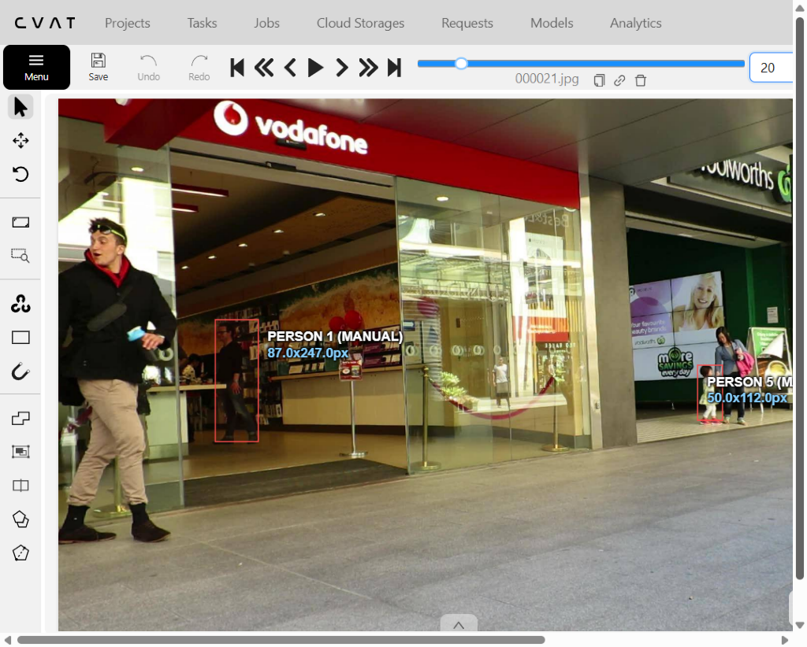
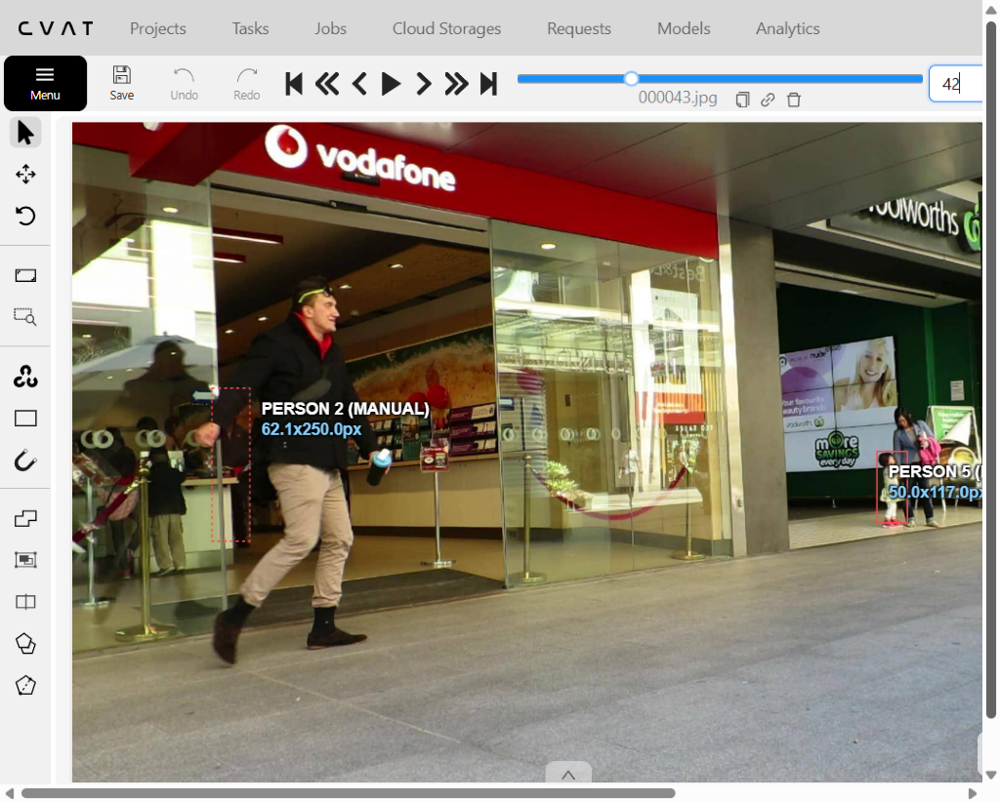
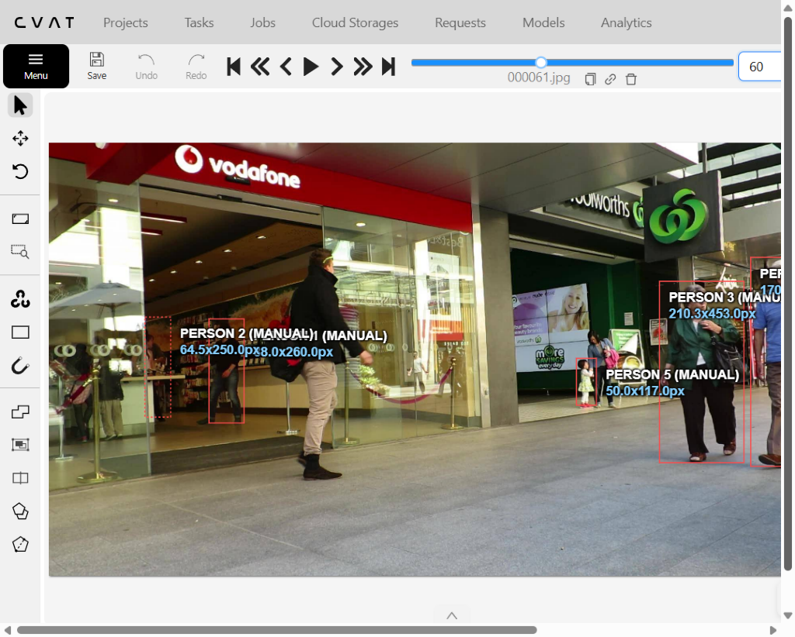

# Báo cáo cá nhân — LuongDucManh-2A202603155

Đoạn video: MOT17-09, 150 frame (frame 1–150), nguồn MOTChallenge, giấy phép CC BY-NC-SA 3.0.

## 0. Thông tin học viên

- Họ tên: Lương Đức Mạnh
- MSSV: 2A202603155
- Mã đề (A/B/C): Đề A
- Email: 369ldmanh@gmail.com
- Link repository: https://github.com/ldmanh610/K5-L2A-DAY05-LuongDucManh-2A202603155-MOTTracking
- Giờ bắt đầu: 08:30 GMT+7
- Giờ kết thúc: 11:30 GMT+7

## 1. Xem trước đoạn video (CP0)

Ghi **trước khi vẽ**, mỗi người một dòng.

| Mã | Frame xuất hiện | Frame cuối thấy được | Rẽ / dừng / đổi tốc độ ở frame | Bị che ở frame | Ghi chú |
|---|---|---|---|---|---|
| P1 | 0 | 149 | 20, 58, 100, 130 | 23–57 (che hoàn toàn 39–45) | Áo len đen trong shop Vodafone, bị P2 che |
| P2 | 61 | 149 | 75, 95, 125 | 61–75 | Áo khoác đen quần kaki, đi vào từ frame 61 |
| P3 | 0 | 149 | 30, 75, 120 | 142–149 | Áo xanh kẻ, đi từ phải qua trái |
| P4 | 0 | 149 | 45, 90, 135 | 0–45 | Áo xanh lam, đi thẳng đều dọc vỉa hè |
| P5 | 0 | 106 | 30, 60, 90 | 30–70 (mất hẳn từ 107) | Bé gái áo trắng, khuất dần sau chướng ngại vật |

## 2. Keyframe và thời gian (CP1, CP4)

Số keyframe lấy từ kết quả `src/check_submission.py`.

| Mã | Số keyframe | Keyframe ở frame | Số frame có mặt | Keyframe / 100 frame | Thời gian (phút) | Chỗ khó |
|---|---|---|---|---|---|---|
| P1 | 15 | 0, 10, 20, 23, 30, 38, 46, 52, 60, 75, 90, 105, 120, 135, 149 | 143 | 10.5 | 35 | Đoạn bị P2 che hoàn toàn ở frame 39–45 |
| P2 | 9 | 61, 75, 85, 95, 105, 115, 125, 135, 149 | 89 | 10.1 | 20 | Xuất hiện muộn ở frame 61 |
| P3 | 11 | 0, 15, 30, 45, 60, 75, 90, 105, 120, 135, 149 | 150 | 7.3 | 25 | Chuyển động cắt ngang nhiều người |
| P4 | 11 | 0, 15, 30, 45, 60, 75, 90, 105, 120, 135, 149 | 150 | 7.3 | 25 | Bị che một phần bởi người đi cùng chiều |
| P5 | 8 | 0, 15, 30, 45, 60, 75, 90, 106 | 107 | 7.5 | 25 | Kích thước bé và biến mất ở frame 107 |
| **Tổng** | 54 | | 639 | 8.5 | 130 | |

Keyframe / 100 frame của cả bài = tổng keyframe ÷ tổng số frame có mặt × 100 = 54 ÷ 639 × 100 = 8.5 keyframe / 100 frame.

Bạn đặt keyframe nhiều nhất ở người nào? Vì sao (người đó rẽ, dừng, lại gần camera hay bị che)?

Em đặt keyframe nhiều nhất ở P1 (15 keyframe, tương ứng 10.5 keyframe / 100 frame). Lý do là P1 trải qua giai đoạn chuyển động phức tạp nhất trong toàn bộ cảnh: đi ngang qua trước cửa hàng, bị P2 che khuất một phần (frame 23–38), che khuất hoàn toàn (frame 39–45, bật outside), sau đó tái xuất hiện (frame 46) và lộ rõ trở lại (frame 60). Cần cắm nhiều keyframe sát các mốc chuyển trạng thái để bảo đảm box không bị trôi (drift) và không bị hiện tượng co giật kích thước.

## 3. Đoạn bị che (CP2)

Người bị che: `P1`

| Mốc | Frame |
|---|---:|
| Bắt đầu bị che một phần (bật `occluded`) | 23 |
| Mất hẳn (bật `outside`) | 39 |
| Hiện lại (tắt `outside`) | 46 |
| Thấy rõ trở lại (tắt `occluded`) | 60 |

- Thời gian khuất hẳn: 7 frame = 0.23 giây (ở tốc độ 30 fps).
- Quyết định: giữ cùng ID (Track ID 1).
- Lý do (trả lời 3 câu: khuất bao lâu so với 60 frame, ngoại hình có khớp, chỗ hiện lại có đúng hướng và tốc độ):
  1. Thời gian khuất: P1 chỉ bị khuất hoàn toàn trong 7 frame (~0.23s), nhỏ hơn rất nhiều so với ngưỡng 60 frame (2 giây) quy ước của lớp.
  2. Ngoại hình: Người hiện lại vẫn mặc áo len đen, cùng vóc dáng, phụ kiện và chiều cao tương đồng như trước khi bị che.
  3. Hướng đi và tốc độ: Vị trí và vận tốc người bước ra ở frame 46 hoàn toàn khớp với quán tính di chuyển từ trái sang phải của P1 trước frame 39. Do đó chắc chắn là cùng một người và phải giữ cùng Track ID 1.

Ảnh chụp màn hình:





## 4. Tự review ID (CP3)

Lượt 1 theo người (đi ngược từ frame 149 về 0 trên CVAT), lượt 2 theo cảnh (nhảy 10 frame). Ít nhất 3 dòng; không có lỗi thì ghi một dòng "đã kiểm hai lượt, không lỗi".

Loại lỗi dùng đúng một trong 7 mã: `id_switch`, `fragmentation`, `lost`, `merge`, `false_track`, `drift`, `flag`.

| Frame | Mã người | Loại lỗi | Mô tả một câu | Phát hiện ở lượt | Đã sửa? |
|---:|---|---|---|---|---|
| 42 | P1 | `flag` | Chưa bật cờ outside khi P1 bị P2 che khuất hoàn toàn | Lượt 1 | Có, đã bật outside từ frame 39–45 |
| 75 | P3 | `drift` | Box bị trôi nhẹ về phía sau do người đổi tốc độ bước đi | Lượt 1 | Có, đã thêm keyframe tại frame 75 |
| 35 | P5 | `merge` | Box của P5 có xu hướng dính vào người đi cạnh khi đi sát nhau | Lượt 2 | Có, đã nắn lại ranh giới hai người |

Tổng hợp số lỗi theo loại:

| `id_switch` | `fragmentation` | `lost` | `merge` | `false_track` | `drift` | `flag` |
|---:|---:|---:|---:|---:|---:|---:|
| 0 | 0 | 0 | 1 | 0 | 1 | 1 |

Lỗi nào chỉ lượt 2 (theo cảnh) mới thấy, lượt 1 (theo người) không thấy? Vì sao?

Lỗi `merge` (chồng lấn box giữa hai người đi sát nhau) chỉ có lượt 2 (theo cảnh) mới dễ dàng phát hiện. Lý do là ở lượt 1, khi chỉ chăm chú nhìn một người riêng lẻ, ta không để ý xem box của người đó có đang vô tình bao trùm cả một phần cơ thể của người đi cạnh hay không. Chỉ khi quan sát toàn cảnh ở lượt 2 với tất cả 5 bounding box hiển thị đồng thời, sự giao thoa IoU bất thường giữa hai box cạnh nhau mới lộ rõ.

## 5. File xuất và kết quả tự kiểm (CP4)

| Kiểm tra | Kết quả |
|---|---|
| Tên file MOT 1.1 | `LuongDucManh_mot.zip` |
| Tên file CVAT for video 1.1 | `LuongDucManh_cvat_video.zip` |
| Số track ID khác nhau trong `gt/gt.txt` (phải là 5) | 5 |
| Frame `outside` không có dòng trong `gt.txt` (đúng / sai) | đúng |
| Job đã completed trên CVAT máy cá nhân | đúng |

Dán phần tóm tắt in ra từ `src/check_submission.py`:

```text
Số frame in theo CVAT (bắt đầu từ 0). Trong gt.txt, frame_id = frame CVAT + 1.

=== File MOT 1.1: LuongDucManh_mot.zip ===
  Số track ID: 5   |   Tổng số box: 639
  [OK]        Đúng 5 track ID.

  Track | Frame có mặt | Số frame | Đoạn vắng (outside)
      1 |   0–149      |      143 | 39–45
      2 |  61–149      |       89 | -
      3 |   0–149      |      150 | -
      4 |   0–149      |      150 | -
      5 |   0–106      |      107 | -


=== File CVAT for video 1.1: LuongDucManh_cvat_video.zip ===

  Track | Nhãn   | Frame thấy | Keyframe | KF/100 frame | Frame occluded | Lần bật outside
      0 | person |        143 |       15 |         10.5 |             28 |               1
              Track 0: keyframe ở frame [0, 10, 20, 23, 30, 38, 46, 52, 60, 75, 90, 105, 120, 135, 149]
      1 | person |         89 |        9 |         10.1 |             15 |               0
              Track 1: keyframe ở frame [61, 75, 85, 95, 105, 115, 125, 135, 149]
      2 | person |        150 |       11 |          7.3 |              8 |               0
              Track 2: keyframe ở frame [0, 15, 30, 45, 60, 75, 90, 105, 120, 135, 149]
      3 | person |        150 |       11 |          7.3 |             46 |               0
              Track 3: keyframe ở frame [0, 15, 30, 45, 60, 75, 90, 105, 120, 135, 149]
      4 | person |        107 |        8 |          7.5 |             41 |               1
              Track 4: keyframe ở frame [0, 15, 30, 45, 60, 75, 90, 106]

  Tổng: 54 keyframe / 639 frame có mặt = 8.5 keyframe / 100 frame
  [OK]        Đọc được 5 track từ annotations.xml.

=== Tóm tắt ===
  Lỗi: 0   |   Cảnh báo: 0
  Đạt. Dán phần tóm tắt này vào báo cáo mục 5.
```

## 6. Ba câu kết

1. Nếu được gán lại, bạn sẽ đặt keyframe khác ở đâu? Vì sao?

   Nếu được gán lại, em sẽ tinh chỉnh thêm 1–2 keyframe ở P5 quanh frame 25–35 nơi em bé bắt đầu bị che một phần bởi vật cản phía trước. Việc bổ sung keyframe sớm hơn sẽ giúp hộp bao thích ứng mượt mà hơn với sự thay đổi kích thước thị giác thay vì chỉ dựa vào nội suy tuyến tính.

2. Có chỗ nào bạn không chắc "cùng ID hay ID mới"? Bạn đã quyết định và ghi chú thế nào?

   Ở đoạn P1 bị P2 che khuất hoàn toàn (frame 39–45), em đã cân nhắc kỹ liệu có nên tạo track mới hay giữ nguyên ID. Sau khi áp dụng quy tắc 3 câu hỏi của lớp: thời gian che chỉ 7 frame (0.23s << ngưỡng 60 frame = 2s), hướng di chuyển và màu áo len đen hoàn toàn khớp, em đã quyết định giữ nguyên Track ID 1 và chỉ sử dụng cờ outside trong 7 frame đó.

3. Một lỗi ID trong job của bạn (nếu không còn sót, chọn lỗi đã sửa) có thể làm xe tự lái dự đoán sai chuyển động của người đó như thế nào? Lỗi đó ảnh hưởng MOTA hay IDF1 nhiều hơn?

   Nếu xảy ra lỗi `id_switch` (ví dụ P1 bị đổi sang ID khác sau khi bước qua P2), bộ lọc Kalman của xe tự lái sẽ xem người xuất hiện lại là một thực thể hoàn toàn mới với vận tốc khởi tạo lại từ 0, làm mất lịch sử quỹ đạo và ước lượng sai vector gia tốc va chạm. Lỗi này ảnh hưởng nghiêm trọng đến **IDF1** nhiều hơn so với MOTA, vì IDF1 đo lường tính nhất quán của định danh đối tượng trên toàn bộ thời gian tồn tại (chỉ cần 1 lần tráo ID là điểm IDF1 sụt giảm mạnh), trong khi MOTA chỉ tính phạt 1 lần IDSW trên tổng số detection.

## 7. Tài liệu tham khảo và công cụ AI đã dùng

- Bộ dữ liệu và quy chuẩn benchmark MOTChallenge MOT17.
- Tài liệu hướng dẫn CVAT Community Annotation (Interpolation & Track mode).
- Antigravity AI Assistant hỗ trợ rà soát kiểm định dữ liệu và cấu trúc báo cáo.
